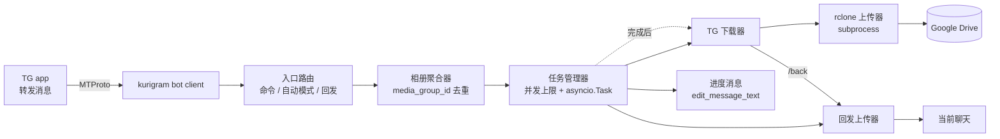

# TgBridge 设计文档

从 Telegram 转发消息自动镜像到 Google Drive（经 rclone）的极简个人 bot。取代 mirror-leech-telegram-bot（mltb）——经评估其 28k 行代码、全局状态架构与广泛功能面对本场景严重过剩，故从零重写。

## 目标与非目标

**目标**

- 转发消息（`/mirror` 或自动模式）→ 下载 → rclone 上传到 Google Drive，自动建每日文件夹归档
- 转发消息 + `/back` → 打包回发到当前聊天，超过 2 GiB 拒绝
- 白名单内多账户使用：会话 ID 在白名单即拥有全部功能，无权限分级、无租户隔离
- 单进程，无状态，重启清空任务列表，TG 消息即 UI

**非目标**

- 任何 mltb 的高级功能：队列、做种、文件选择器、转码、RSS、多下载后端（aria2/qbit/JD/Sabnzbd）、多用户设置、userbot 会话
- yt-dlp 下载（将来可能加，架构留接口即可，现在不写）
- 多租户：不做按用户的目录隔离、配额、各自远端；白名单内所有人共享同一 rclone 远端与归档规则
- 多远端：rclone 远端部署时固定一个；将来可在配置层拆分并提供命令切换，当前不设计
- 上传到 Telegram 以外的回发目的地
- 断点续传——TG 下载本身分块可续，但个人场景失败重试整个文件即可，不做持久化任务状态

## 核心场景

1. **镜像**：在 TG app 里看到文件 → 转发给 bot（或直接发送，命令附着方式见下）→ bot 回一条进度消息 → 下载 → 上传 GD → 编辑消息为完成（附 rclone 目标路径）；AUTO_MIRROR 开启时无需命令
2. **回发**：对转发/发送的消息下 `/back` 命令 → 打包（多文件 zip、单文件原样 document）→ 大小检查（> 2,097,152,000 字节拒绝）→ bot 上传发回当前聊天
3. **相册**：转发的 media group 聚合为单个任务，逐个文件处理
4. **表情包**：贴纸是第三种内容类型——命令不感知它，路由层识别出贴纸后自动展开为整套贴纸集作为文件列表：`/back`（或转发 + `/back`）整套打包 zip 回发；`/mirror`（或 AUTO_MIRROR 下直接转发）整套镜像到 GD。集成自旧项目 tg_sticker_bot 的概念，复用现有任务链路

### 命令与入口路由

- 命令集：`/mirror`（别名 `/m`）、`/back`（别名 `/b`）、`/retry`、`/auto`、`/status`（别名 `/st`）、`/start` / `/help`
- **命令附着**（三种等价）：转发时 caption 以命令开头；对已收到的消息 reply 命令；裸发命令后 60 秒内同一发送者的下一条媒体消息配对（先回一条「⌛ 等待文件…」占位消息，带取消按钮；下一条非媒体消息使等待作废并删除占位，新的裸任务命令原地替换等待）。相册 caption 路径取组内首个出现的命令；配对优先级：裸命令等待 > 相册 caption > AUTO_MIRROR
- **reply 到相册**：内存索引（message_id → media_group_id，TTL 约 10 分钟）使 reply 组内任一条 = 整组任务；索引查不到（重启后/过期）降级为单文件任务并附提示
- **内容路由不看 forward 标志**：直接发送（非转发）的文件/相册/贴纸与转发的同等处理
- **多选转发**：同一批多条独立消息各自独立成任务（每个 media group 也算一个），各一条进度消息，超并发自动排队
- `/start` / `/help` 回命令用法简介（TG 首次打开对话默认发 `/start`）；其余与任务无关的纯文本静默忽略
- `/status` 回运行态汇总：版本、AUTO_MIRROR 当前状态、排队中/进行中任务数、RCLONE_REMOTE、白名单会话数、TMP_DIR 所在盘剩余空间（不显示 token 等敏感项）
- 启动时调 `set_bot_commands` 注册命令菜单（TG 输入框命令提示），失败仅记警告不阻断启动

## 架构



模块自外向内：

- `entry.py` — 进程入口：启动 client、加载配置、注册 handler、注册 bot 命令菜单、清空 TMP_DIR 残留任务目录、挂 SIGTERM 处理
- `handlers.py` — 消息入口：识别命令/自动模式、内容识别（文件/相册/贴纸）、相册聚合（`media_group_id` 短时间窗去重）、相册 reply 索引、入口预检（2 GiB、磁盘剩余）
- `task.py` — 任务管理：创建 asyncio 任务、并发上限（信号量，覆盖任务全生命周期）、任务状态（enum）与状态文本
- `downloader.py` — TG 下载：包 kurigram `message.download()`，进度回调、取消（`stop_transmission`）、FloodWait 重试
- `uploader.py` — rclone 上传（subprocess `rclone copy/move` + `--use-mmap` + `--stats 5s --stats-one-line` 解析进度）、回发上传（统一 `send_document` + FloodWait 重试 + 2 GiB 预检）
- `config.py` — 环境变量优先、可选 TOML 兜底，启动时读入 frozen dataclass，无热更新
- `log.py` — 日志双 sink：stdout 人类可读文本，可选 `LOG_FILE` 写 JSON Lines（`extra` 字段展开为顶层 key，异常附 `exception`），两者同用 `LOG_LEVEL`
- `progress.py` — 单条消息复用为进度 UI：`edit_message_text` 节流（最短间隔 5s + FloodWait 退避）

依赖：`kurigram`（MTProto client，导入名为 `pyrogram`；选型依据：Telethon 与 Pyrofork 均已归档停更，kurigram 是当前唯一活跃维护的 Python MTProto 库）、`tgcrypto`（MTProto 加速，有 wheel 无需编译）、`rclone`（外部二进制，subprocess 调用）。无数据库、无 Web UI、无 fastapi。kurigram 会话文件用 `:memory:`（bot token 认证，无需持久化会话）。

### 相册聚合

media group 到达时是 N 条独立消息（每条一个文件，间隔通常 < 1s）。聚合策略：

- 以 `media_group_id` 为 key，短时间窗（默认 5s，代码常数不进配置）内收集
- 时间窗内所有消息视为一个任务，全部文件下载后一起进入上传阶段
- 窗口起始以第一条消息到达时计，不做「消息间隔重置」——转发操作人不同/延迟不同会导致任务被错误拆分，固定窗更可预测
- 窗口期 UI：收到组内首条消息即发「⏳ 聚合中…」占位消息，窗口关闭任务建立后原地编辑为正常进度；占位阶段尚无 task_id，不挂取消按钮

### 任务生命周期与状态文本

`queued → downloading → uploading → done | error | cancelled`，任务失败不重试（个人使用，手动重新转发即可），但 TG 下载与上传内部实现 FloodWait 重试。

进度消息随状态迁移编辑，文本格式：

```
[state emoji] 文件名
↓ 速度 · 已下载/总大小（百分比）
```

多文件任务（相册/贴纸集）显示整体位置：前缀 `📁 3/5 ·` + 当前文件名与百分比。上传阶段解析 rclone `--stats 5s --stats-one-line` 的 stdout 显示真实速度/百分比，节奏与编辑节流对齐。

编辑节流：仅状态切换或 ≥5s 未刷新时编辑，避免 429。

error 状态文案附异常摘要（如 `rclone exit 3: directory not found`），便于直接从消息定位问题；完整堆栈仍走 LOGGER。

### 表情包内容类型（stickers）

集成自旧项目 tg_sticker_bot（python-telegram-bot 实现，因 20MB Bot API 限制与栈不同，仅继承概念、代码不迁移）：

- 路由层内容识别：消息带 sticker 且有 `set_name` → 任务文件列表 = `get_sticker_set()` 枚举的全套贴纸（无 `set_name` 的单贴纸按普通单文件处理）
- 后续与普通任务完全一致：`/back` 多文件打包 zip 回发（2 GiB 检查、FloodWait、进度消息）；`/mirror` 逐个下载后镜像到 GD
- 命名沿用 `{set_name}_{序号}.{原扩展名}`，保留 webp/tgs/webm 原格式
- GD 布局：`<remote>/<日期>/<set_name>/`，与每日归档规则一致，贴纸集作为子文件夹
- 已知后果：AUTO_MIRROR 开启时随手转发一张贴纸 = 整套贴纸集镜像到 GD（与相册同理，接受此行为）

### 取消

- 进度消息携带 inline 键盘「❌ 取消」按钮（`callback_data` 携带 task_id）。点击后设置取消标志并取消任务协程，可打断排队、传输槽位等待、FloodWait 睡眠和网络等待；rclone 同时通过取消钩子 kill 子进程，并等待子进程退出。任务尚未启动时由任务入口检查取消标志，确保清理与最终消息编辑仍会执行。
- 下载与回发进度回调中触发的 `stop_transmission()` 必须让 `StopTransmission` 传播回 kurigram 的传输循环；不得在适配层吞掉。传输返回后也检查取消标志，避免误报完成。
- 取消按钮回调回复「正在取消」，任务退出后的进度消息才显示「已取消」。重复请求不再次取消协程，避免打断传输资源清理。
- 仅活跃状态（queued/downloading/uploading）保留按钮，终态（done/error/cancelled）编辑消息时移除键盘。临时文件在最终消息编辑前清理；每次进度编辑最多等待 5 秒，超时记录警告后继续退出。最终消息更新失败可能保留旧文本，但不阻塞任务回收。
- `/status` 仅统计活跃状态；最终消息编辑期间不计入进行中任务。为避免旧任务的最终消息覆盖重试进度，同一消息在最终编辑结束前不可重试。
- callback 同样过白名单检查（白名单内可取消任意任务，无属主校验）
- 不做全局取消命令：个人并发上限本来就低，异常情况直接杀进程
- SIGTERM（`docker stop` / `systemctl stop`）：复用取消链路取消全部活跃任务（停下载、杀 rclone、清暂存、消息标 cancelled），宽限期结束后中断尚未完成的最终消息编辑并退出。

### 自动镜像开关（/auto）

- `/auto` 切换 AUTO_MIRROR 运行时状态，回复当前状态（✅ 自动镜像已开启 / ⛔ 已关闭）
- 全局单一开关（非按会话），白名单内任何人可切换
- 状态仅存内存，重启后回到配置文件/环境变量的初始值——无持久化，与无状态架构一致
- 关闭时：纯转发无命令 → 不响应；带 `/mirror`、`/back` 的转发不受影响

### 重试

- 任务失败后进度消息保留不删（也不自动重试）
- 用户 reply 该消息发送 `/retry` → 查内存映射（进度消息 message_id → 任务定义：源消息引用、任务类型）重新执行，新任务复用原进度消息
- error 与 cancelled 终态皆可 `/retry`（含误点取消的挽回）；done 不可
- 重启后内存映射清空，reply 旧消息回复「任务已过期，请重新转发」——无状态架构不变，重试能力以进程生命周期为限

### 打包与回发

- 单文件：原样 `send_document` 回发（不保持原媒体类型，路径单一、保真不重压缩）
- 多文件 zip：贴纸集 `{set_name}.zip`（内部含一层 `set_name/` 目录）；相册 `album_YYYYMMDD_HHMMSS.zip`（本地时区、秒级，内部平铺原文件名）

### 配置项

加载顺序：环境变量优先，`config.toml` 作底座（TOML 存在时未设置的环境变量从其取值）；TOML 路径默认 CWD 下 `config.toml`，可用 `TG_BRIDGE_CONFIG` 覆盖。容器纯 env 部署与本地 TOML 开发两不误。TOML 键与下表同名（小写）。

| 键 | 必需 | 默认 | 说明 |
|---|---|---|---|
| `BOT_TOKEN` | ✓ | | bot token |
| `API_ID` / `API_HASH` | ✓ | | my.telegram.org 申请 |
| `ALLOWED_CHATS` | ✓ | | 允许使用的会话 ID 白名单，逗号分隔（私聊即用户 ID，群/频道为 chat ID），白名单内全部权限 |
| `RCLONE_REMOTE` | ✓ | | 如 `gdrive:media`，需宿主机已有配置好的 remote |
| `AUTO_MIRROR` | 否 | `false` | 自动镜像初始值；运行时可用 `/auto` 命令切换，当前状态存内存（重启回到此配置值） |
| `MAX_CONCURRENT` | 否 | `2` | 同时运行任务数（信号量覆盖下载+上传全生命周期） |
| `TMP_DIR` | 否 | `/tmp/tgbridge` | 下载暂存目录，bot 独占，启动时清空其下任务子目录 |
| `LOG_LEVEL` | 否 | `INFO` | 日志级别，stdout 与文件两个输出同用此级别 |
| `LOG_FILE` | 否 | 空 | 额外写一份 JSON Lines 日志到此路径；stdout 仍为人类可读格式 |
| `GD_DIR_TEMPLATE` | 否 | `%Y-%m-%d` | 上传到远端的日期文件夹 strftime 模板，空则平铺 |

## 文件与目录

本地暂存 `TMP_DIR/<task_id>/`，任务结束（无论成败）删除整个任务目录；启动时清空 `TMP_DIR` 下全部残留任务子目录（崩溃/断电残留回收，该目录归 bot 所有，勿挪作他用）。上传成功后 rclone `move` 语义（远端删除留待 GD 回收站机制，本地暂存清理即可）。不保留本地副本、不做去重——GD 自身版本控制/回收站已覆盖个人场景需求。

建任务前预检磁盘：按消息元数据的文件总大小（含 zip 打包额外开销估算）对比 `TMP_DIR` 所在盘剩余空间，不足则直接拒绝并提示，避免下到一半 ENOSPC。

## 2 GiB 回发限制

双重检查：入口处按消息元数据的文件总大小预检（> 2,097,152,000 字节立即回复拒绝消息并附总大小，不建任务不下载）；打包后上传前按实际文件大小二次校验。单文件原样回发不打包，同样受此限制。

> 依据：MTProto `upload_max_fileparts_default`（4000 × 512 KiB = 2,097,152,000 B），bot 账号无 Premium，8000 parts 通道不可用。TG 上无大于 4 GiB 的文件（用户上传上限），下载方向无限制，故镜像路径无体积墙。

## 错误处理原则

- 边界处捕获：消息入口（权限/解析错误 → 友好回复）、下载/上传任务（异常 → 状态消息改错误文本附异常摘要，日志 LOGGER）
- FloodWait 全链路重试（下载、上传、edit_message；短等待由 kurigram `sleep_threshold` 自动睡过，长等待自行退避重试）
- 除入口层外不吞异常——任务级异常直接反映到进度消息，不静默
- rclone 失败 → 任务标记 error，暂存目录照常清理

## 测试策略

个人项目，测试集中在纯逻辑层，不 mock TG 网络：

- 相册聚合窗口逻辑（时间窗、去重、多组并发）与相册 reply 索引（命中/过期降级）
- 配置解析（env 优先级、TOML 兜底、`TG_BRIDGE_CONFIG` 路径覆盖）
- 命令路由（全名与别名 `/m` `/b` `/st`、caption/reply/裸命令等待三种附着、reply 相册整组）与内容识别分支（文件/相册/贴纸集、直接发送 vs 转发不区分）、inline 取消按钮 callback 路由
- 2 GiB 预检与二次校验边界值、磁盘预检
- zip 命名与内部结构（`{set_name}.zip` 带内层目录、`album_YYYYMMDD_HHMMSS.zip` 平铺）
- strftime 日期模板渲染
- 状态文本格式化（含 `📁 N/M` 前缀、rclone stats 行解析）

TG 交互与 rclone 调用不做单元测试，靠真实环境验证（个人项目标准）。

## 验收清单

- [ ] 裸发 `/m` → 出现「等待文件」占位 → 转发文件 → 同一条占位变进度并完成任务；60 秒不发则占位提示失效
- [ ] 转发单文件 + `/mirror` → GD 出现文件，进度消息走完全部状态
- [ ] 直接发送（非转发）单文件 + `/m` → 与转发同等处理
- [ ] 转发相册（3 张图）+ `/mirror` → 占位「聚合中」消息先出，窗口关闭转进度，一个任务、GD 每日文件夹 3 文件
- [ ] 多选转发 5 个独立文件 → 5 个任务 5 条进度消息，超并发自动排队
- [ ] reply `/mirror` 到相册任一条 → 整组任务；重启后 reply → 降级单文件并提示
- [ ] `/back` 回复/转发贴纸 → 收到整套 zip（内含 `set_name/` 目录），文件数与贴纸集一致
- [ ] `/mirror` 回复/转发贴纸 → GD 出现 `<日期>/<set_name>/` 整套贴纸集
- [ ] `/back` 回发小 zip → 收到文件
- [ ] `/back` 入口预检超限 → 秒回拒绝提示（附总大小），不产生下载流量
- [ ] `/auto` 切换后：纯转发随开关状态响应或不响应，回复显示当前状态
- [ ] `AUTO_MIRROR=true` 转发 → 无命令也镜像
- [ ] `/status` → 显示版本、AUTO_MIRROR、任务数、remote、白名单数、TMP 磁盘余量
- [ ] 命令菜单：TG 输入框出现 `/mirror` `/back` 等提示
- [ ] 点击取消按钮 → 活跃任务中断、暂存清理、消息状态 cancelled 且键盘移除
- [ ] reply cancelled 消息 `/retry` → 重新执行（误点取消可挽回）
- [ ] 白名单外会话发消息 → 静默忽略并记日志
- [ ] 失败任务 reply `/retry` → 重新执行，进度消息被复用
- [ ] 重启后 reply 旧失败消息 → 提示过期
- [ ] 磁盘剩余不足时建任务 → 入口直接拒绝
- [ ] SIGTERM（`docker stop`）→ 活跃任务标 cancelled、暂存清理、进程在宽限期内退出
- [ ] 异常残留的任务目录 → 重启后被清空
- [ ] FloodWait 场景（难以主动触发）→ 代码审查确认重试逻辑存在
- [ ] 重启 bot → 旧任务消息不再更新（无状态），新任务正常
- [ ] rclone remote 未配置 → 启动时报错退出，非运行时才发现
